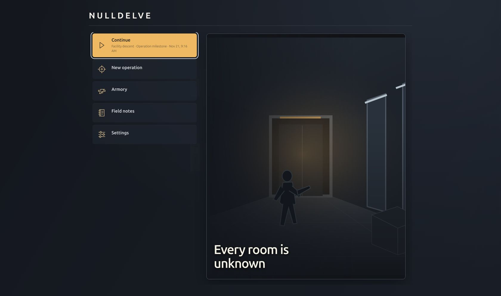

# NULLDELVE — Tactical breach

An early playable browser preview of a three.js tactical shooter with fog of war, environmental puzzles, giant mutated cockroaches, and staged hordes.

## Play

Online: https://ajavadinezhad.github.io/nulldelve/

Run `python3 -m http.server 8000 --bind 127.0.0.1` from this folder, then open http://localhost:8000. No npm installation or internet connection is needed. three.js r180 is bundled in `vendor/`.

## Phone controls

Touch devices automatically get two thumbsticks: left moves (push to the outer edge to sprint), right aims and fires. Interact, Reload, Swap and Melee are large tap targets; medkit, grenade and map remain available in the HUD. Touch controls can be set to Automatic, On or Off in Settings → Controls. Pause and cancelled touches release held input. Crates can be reset from Help.

## Controls

- WASD: movement; Shift: sprint.
- Mouse: aim; left click: fire.
- Arrow keys: independent keyboard aiming; Space: fire.
- E: doors, consoles, clues, and confirmed departure at a marked sector exit.
- R: reload; 1 / 2: equipped primary / sidearm; F: knife strike.
- M: full discovered map; scroll over the game: zoom.
- Q: medkit; G: grenade. Armory purchases happen at base before deployment.
- T: reset unsolved pressure-plate crates.
- Esc: pause and menu; H: controls.

## Operations

New operation opens Facility Descent, then an illustrated ruined-site map. Five known locations unlock in sequence: Breach, Command, Research, Containment, and Nest & Evacuation. Finish the previous operation to deploy to the next; completed operations remain replayable. Unknown terrain stays under cloud without future markers or a displayed content total. Each deployment has its own start, encounter set, objectives, and visual identity. Earlier saves of the full facility remain playable. Clearing objectives reveals a marked sector exit; use Interact there to depart. Only the final evacuation shows Mission complete.

The campaign spans 14 connected rooms across a 101 × 69 facility. Its first puzzle powers a door by pushing two marked crates onto pressure plates. The Archive has a glyph sequence and Security has timed relays. Ten progressively staged encounters total 362 baseline creatures, beginning with 8 and growing to 80 deeper in the facility, with staged reinforcements and a global cap of 36 living enemies. Exit seals remain locked until every queued reinforcement is eliminated. Nest intel and southeast evacuation finish the campaign.

Legacy Reactor Siege saves require routing three power nodes, clearing 40 creatures, and holding inside Reactor for a 20-second evacuation. Legacy Nest Hunt saves deploy directly into its combat operation. The campaign adds a reactor power sequence, alternating containment valves, and three optional research logs; recovered logs can be reread under Mission details in the pause menu. All difficulties keep the operator at 100 HP and use the same magazines, reserve budgets, enemy movement speed, and bite damage. Recruit fields 75% of the baseline creatures with 80% toughness and slower reinforcements. Operator uses baseline opposition. Veteran fields 135% of the creatures with 150% toughness, faster reinforcements, and flanking approaches. Deployment shows these shared gameplay values. Saved active waves retain their existing counts.

Brown roaches are standard; green runners are fast, purple brutes are armored, and large red mutations are bosses. Alerted hordes navigate around furniture. Injured enemies show health bars only while visible.

## Armory and saves

Kills earn money and drop ammunition. Regular ammunition appears about every third kill; health appears occasionally when injured. Critical supplies receive modest assistance, while nearby unused supplies prevent excess drops. Brutes and bosses provide larger, controlled rewards. Pickups appear as grounded ammunition cases and medical pouches. Walk over supplies to collect them; unused supplies remain on the floor and persist in saves. Reloading uses the displayed reserve ammunition. A short forward knife strike remains available when ammunition runs out. The pistol hits harder per shot and briefly staggers a creature; the carbine provides sustained fire. Creatures signal bites before striking, and a short shared damage grace prevents simultaneous bites from stacking instantly. The predeployment armory sells the VX9 SMG, BREACH-12 shotgun, SABLE DMR, M60 WARDEN LMG, primary/sidearm upgrades, medkits, grenades, and armor. The shotgun fires five pellets per shell. Money, purchased weapons, selected primary, upgrades, and supplies persist between operations. The primary slot shares reserve ammunition, with smaller shell reserves and drops for the shotgun. Newer purchases survive loading an older checkpoint.

Automatic checkpoints store the operator, ammunition, equipment, discovered map, puzzle states, and complete horde queue. They update after puzzle milestones, cleared hordes, safe room arrivals, and safe intervals during long operations. Continue resumes the automatic checkpoint; manual Save/Load actions are removed. Automatic saves are deferred during combat to protect the safe checkpoint. The armory is available at base before deployment. Existing legacy manual saves remain stored without being selected by Continue. Progress and settings live in this browser on this computer.

The main menu has Continue, New operation, Armory, Field notes, and Settings. Pause puts Resume first, followed by Field notes, Settings, and Main menu. Escape goes back within a panel before resuming. Settings are divided into Controls, Audio, and Display; all gameplay keys can be remapped, and a reduced-effects option suppresses flashes. HUD size adapts to narrow viewports. Shared medkit and grenade icons appear in the HUD and armory; the HUD icons can be clicked to use an item. Procedural gun, reload, door, creature, explosion, puzzle, and wave sounds accompany a quiet atmospheric drone. Sound starts only after user interaction and pauses with play.

The browser page stays fixed; long menus scroll within game panels. Mission cards use locally rendered 3D previews.

First-time campaign players receive a skippable five-step field introduction. Mission endings show time, kills, exploration, shots, and supplies used; successful times are saved as personal bests per mission and difficulty.

## Checks

Run each `tests/*.test.cjs` file with Node. Tests cover furnished puzzle solvability, map connectivity, collision, door seals, queued hordes, save restoration, checkpoints, purchases, inventory limits, enemy attacks, and health bars.

## Session reliability

Gameplay uses fixed simulation steps to keep movement and timers consistent across frame rates. Reloads reset to zero on completion. Losing focus pauses even with the full map open. After loading, Retry restarts the same mission and difficulty, and matching checkpoints can be restarted directly. Loading reconstructs current mission instructions and shows discovered consoles on the map.

Session regression checks exercise actual capture/restore, repeated reloads, focus loss, checkpoint protection, retry URLs, damage grace, and low-frame-rate timing in addition to the module checks.

Puzzle help uses layered clues: environmental guidance first, then optional clearer hints through Help. Routine kill and reload notifications are kept quiet. The compact HUD groups health, a blue armor bar, weapon, ammo, and supplies in one panel; reading Help pauses simulation.

## Puzzle library

Open `/puzzle-lab.html` for Field notes. It only displays systems encountered nearby and in sight during play; unseen types, their names, and the library total stay hidden. New games start with an empty journal. The internal library begins with 20 presets and can grow to 40 or more; each operation selects a suitable subset. The journal is view-only: reference diagrams and optional hints cannot solve or change the real in-world puzzle. Seed, export, and automatic solution tools are hidden from the player journal.

The bundled three.js runtime is distributed under the MIT license; see [vendor/LICENSE](vendor/LICENSE).

## Project folders

- `src/`: game modules and interface logic.
- `styles/`: game and menu styles.
- `assets/`: icons, artwork, and screenshots.
- `vendor/`: bundled three.js and its license.
- `tests/`: automated checks and browser fixtures.
- `docs/`: review notes.

GitHub Pages serves the root HTML pages from `main`. All runtime paths are relative so the game works under the repository URL.

## Early preview

Desktop browsers are the primary preview target. Touch controls are available experimentally; physical Android/iPhone performance and fresh-player playtests are still pending. Progress is stored in the current browser.

[Report a bug or confusing interaction](https://github.com/ajavadinezhad/nulldelve/issues/new?template=bug_report.yml). Include the operation, difficulty, device/browser, and what happened.

Preview asset: [share image](assets/preview/share-card.jpg). The low-frame-rate automated GIF has been retired.

For a human-played video, open [capture mode](https://ajavadinezhad.github.io/nulldelve/?capture=1), deploy, and press F9 to start/stop. Select 1080p or 4K; both request 60 fps, with 20/50 Mbps video targets and game audio (takes up to 90 seconds). Recording excludes the HUD and recording toolbar, pauses with play, and offers an MP4 download when supported (WebM otherwise). Actual frame rate depends on the device. No microphone or screen sharing is used. Record short, deliberate exploration/puzzle/combat takes; no automated movement is included. The share card can be regenerated from `tools/preview-card.html`.

## Grenades and operator actions

Hold G (or hold the grenade icon) to build throw strength and preview its arc; release to throw. Quick taps lob nearby, longer holds reach farther. Walls limit the landing point. Detonation follows the visible flight. Reloads use phased hand and magazine motion; grenade throws have windup, release and recovery. Result screens keep checkpoint restart prominent and put statistics under Run details.
